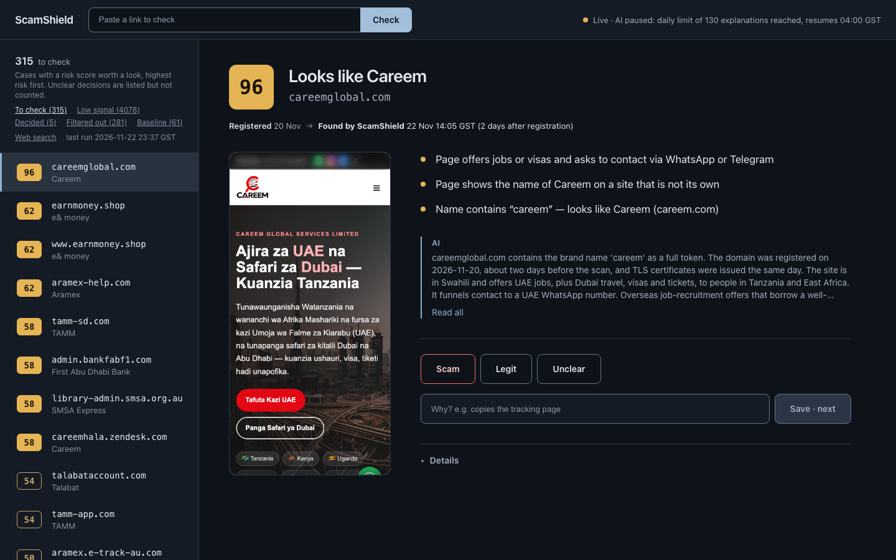
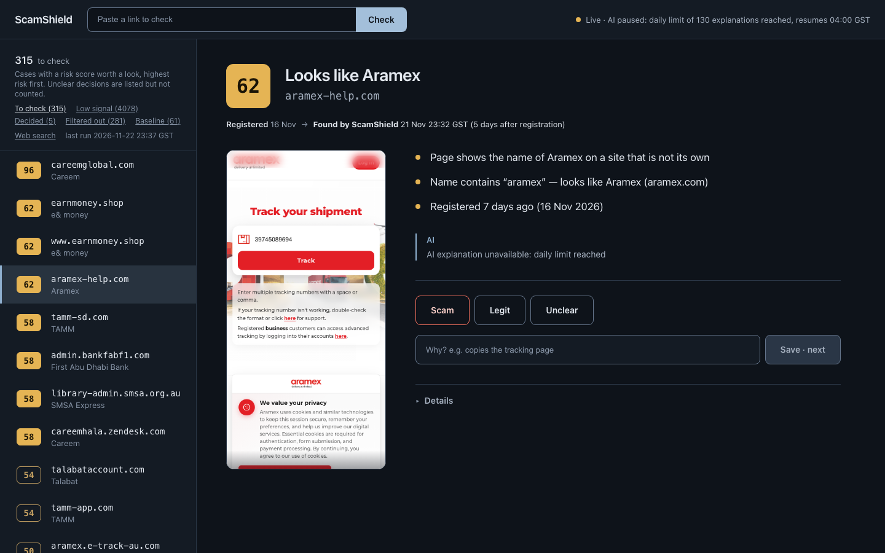
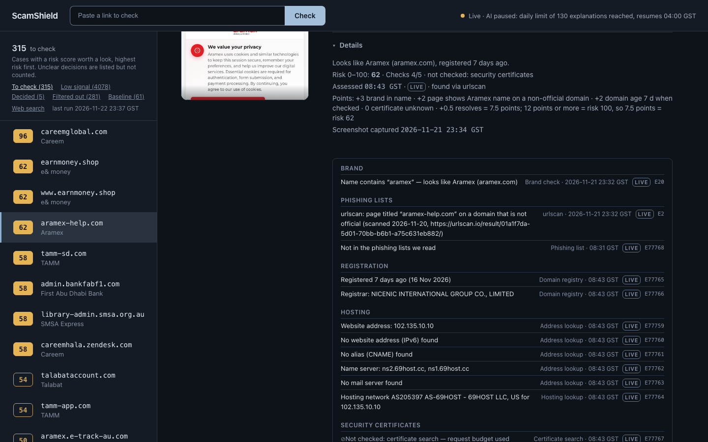
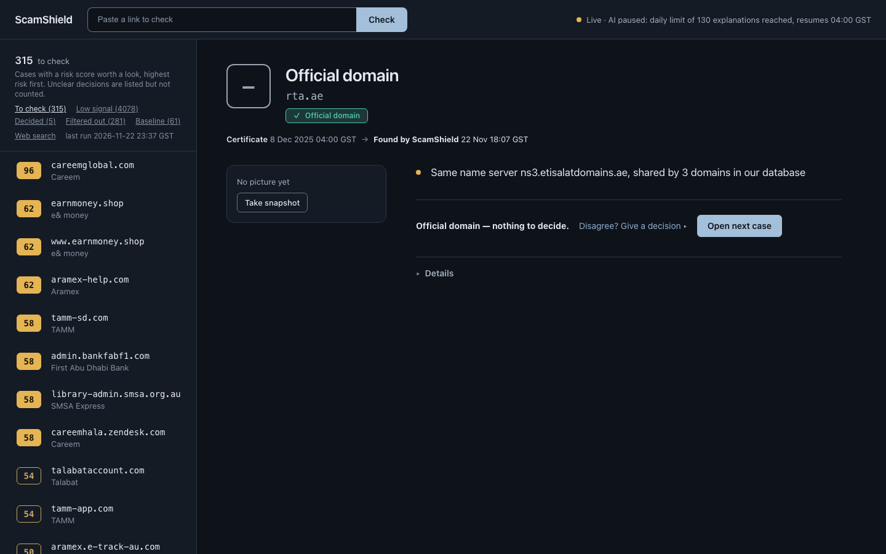
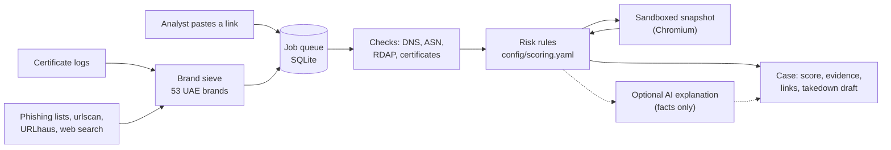

# ScamShield

**Early warning for fake websites that imitate UAE brands.**

[](https://github.com/neostorm112-boop/scamshield/actions/workflows/ci.yml)
[](LICENSE)

Scammers register a new domain, get a free HTTPS certificate and send the link by SMS or WhatsApp: "Your RTA fine is
unpaid", "Aramex: parcel on hold", "Careem is hiring in Dubai". ScamShield watches the public certificate logs, where
every new HTTPS website appears within seconds, and catches the names that look like 53 UAE brands (RTA, Salik,
Police, TAMM, Emirates Post, Aramex, banks, telecoms, airlines, delivery apps). Each suspicious domain becomes a case
with a risk score and numbered evidence, so an analyst can decide in a minute and send a takedown request.

It runs on a laptop: one Python process, a SQLite file, no Docker, **no API keys required**.



## What it does

- **Watches certificate-transparency logs** (Let's Encrypt, Google, Geomys) live and matches every new name against
  the brand list: brand tokens, look-alike letters (`rta` / `rtа` in Cyrillic), typos, IDN tricks, brand inside a longer
  name (`aramex-help.com`, `salik-pay.top`).
- **Checks each candidate**: DNS, hosting network (ASN), registration date (RDAP), certificate history, public phishing
  lists. Every fact is stored with its source and time and gets an evidence number `E…`.
- **Takes a safe snapshot** of the page in an isolated headless Chromium (never clicks, never types, blocks private
  addresses and downloads) and reads the title, form fields, logo and favicon. A page that shows the Aramex logo on a
  domain that is not Aramex's is a strong signal.
- **Scores the risk with fixed rules** (`config/scoring.yaml`): points for brand match, page content, card/OTP forms,
  domain age and links to other fake sites. The card shows the arithmetic. Unknown is never treated as safe.
- **Links related domains** that share a name server, a rare IP or the same phishing kit, so one case can expose a gang.
- **Paste any link** to get a case in seconds. Official brand domains are recognised and not flagged.
- **Optional AI explanation** (Claude) turns the facts into plain words and cites evidence numbers. The AI never sets
  the score; it only explains facts that already exist. Spending has a hard daily cap.
- **Takedown draft**: a plain-text abuse report built from the stored evidence (the app never sends it itself).

| Page snapshot in a sandbox | Numbered evidence with source and time |
|---|---|
|  |  |



Phone numbers of the scam sites are blurred in these screenshots.

## Results from a live run

Measured on a MacBook during a 9.4-hour live run (22 Nov 2026):

- about 89 million certificates read from the logs, 0 log segments skipped;
- median 1.8 seconds from a certificate appearing in the log to the domain appearing in the queue;
- flagged cases included `careemglobal[.]com` (a recruitment page that appears to impersonate Careem and asks visitors
  to contact a WhatsApp number, flagged 2 days after registration) and `aramex-help[.]com` (a page that copies the
  Aramex parcel-tracking page).

These are flagged cases, not confirmed findings: the tool ranks domains for a human analyst, it does not accuse
anyone. Domains are written with `[.]` so they are not clickable; do not visit them outside a sandbox.

## Quick start

Requirements: macOS or Linux (on Windows use WSL2), Python 3.12 or newer, internet access, about 1 GB of free disk
space (Chromium).

**1. Install Python 3.12** if `python3.12 --version` does not work:

| System | Command |
|---|---|
| macOS | `brew install python@3.12` (Homebrew: <https://brew.sh>) |
| Ubuntu 24.04, Debian 13 | `sudo apt install python3.12 python3.12-venv` |
| Ubuntu 22.04 | `sudo add-apt-repository ppa:deadsnakes/ppa && sudo apt install python3.12 python3.12-venv` |
| Windows | Install WSL2 with Ubuntu (`wsl --install`), then follow the Ubuntu line inside it |

**2. Get the code and start it:**

```bash
git clone https://github.com/neostorm112-boop/scamshield.git
cd scamshield
./run.sh
```

No git? Use **Code → Download ZIP** on GitHub, unpack it and run `./run.sh` inside the folder.

**3. Open <http://127.0.0.1:8000>.**

The first start takes 1–3 minutes and prints little while it works: `run.sh` creates a virtual environment in
`.venv`, installs `requirements.txt`, downloads Chromium for page snapshots and creates the database in `data/`.
Later starts take a few seconds. It is ready when the terminal shows `Uvicorn running on http://127.0.0.1:8000`.

**Check that it works:** paste `rta.ae` into the top bar and press **Check**. Within about 10 seconds the case shows
**Official**. <http://127.0.0.1:8000/healthz> returns a short JSON status while the app is running.

On Linux, if snapshots show "Not checked", Chromium is missing system libraries; install them once with
`sudo .venv/bin/python -m playwright install-deps chromium`.

A log line `ct_tiled: … log(s) skipped, they need CT_CONTACT_EMAIL` is normal without keys: those logs ask for a
contact email (see [Optional keys](#optional-keys)); the other certificate logs still work.

Then:

1. Paste a link into the top bar, for example `rta.ae` (official: no alarm) or any suspicious domain from an SMS
   you received, and press **Check**. The case opens in a few seconds and fills in as checks finish.
2. Leave the app running. Certificate monitoring starts by itself, and new look-alike domains appear in the
   **To check** list on the left, highest risk first. A fresh start shows few cases; real ones arrive over hours.
3. Open a case, look at the snapshot and the evidence under **Details**, then mark it **Scam**, **Legit** or
   **Unclear**. Decisions are stored locally and the next case opens.

To stop, press `Ctrl+C` in the terminal. Data stays in `data/`; delete that folder to start from scratch.

### Settings

| Variable | Default | Meaning |
|---|---|---|
| `PORT` | `8000` | Web port (the app listens on 127.0.0.1 only) |
| `SCAMSHIELD_DATA_DIR` | `data` | Where the database and snapshots are stored |
| `SCAMSHIELD_LIVE` | not set | Set to `1` to show the live-status banner (source health) |

Example: `PORT=8080 ./run.sh`.

### Optional keys

Everything works without keys. Keys unlock extra sources and the AI explanation. Copy `.env.example` to `.env` and
fill in only the ones you have; `run.sh` reads `.env` if it exists. Never commit `.env` (it is in `.gitignore`).

| Variable | Unlocks | Without it |
|---|---|---|
| `ANTHROPIC_API_KEY` | AI explanation of a case and the gray-zone AI label (Claude). Daily spend cap in `config/live.yaml` | Cases work fully; the card says the explanation is unavailable |
| `URLSCAN_API_KEY` | urlscan.io search as an extra discovery source and "find relatives" | Source shows "off – no key", no requests are made |
| `ABUSECH_AUTH_KEY` | abuse.ch URLhaus recent-URL feed | Source shows "off – no key" |
| `TAVILY_API_KEY` | Web search for lure pages (fixed queries from `config/brands.yaml`) | Web search is off |
| `CERTSPOTTER_API_KEY` | Higher CertSpotter limits (certificate history per domain) | Works keyless with the free limit |
| `CT_CONTACT_EMAIL` | Reading the Geomys certificate logs, whose operator asks for a contact email in the User-Agent | Those logs are skipped; Let's Encrypt and Google logs still work |

## How it works



- **Rules decide, AI explains.** The score is a deterministic formula; every weight and threshold is in
  `config/*.yaml`. A malicious page cannot talk its way to a lower score.
- **Every fact has a source and a time.** A source that did not answer is shown as "Not checked", never as "safe".
- **Failures are data, not crashes.** Each source has its own rate budget and timeout (`config/sources.yaml`);
  jobs survive restarts.
- **Privacy.** Inputs are public data (certificate logs, DNS, registries, public lists). Registrant names, emails
  and phones from RDAP are ignored. Nothing is uploaded except the optional AI call (domain facts and page text) and
  the fixed search queries.

More detail: [docs/ARCHITECTURE.md](docs/ARCHITECTURE.md), data model in
[docs/specs/scamshield/DATA.md](docs/specs/scamshield/DATA.md), design decisions in [docs/decisions/](docs/decisions/).

## Project layout

```
scamshield/app.py            web app; startup applies the DB schema and starts the background monitors
scamshield/connectors/       discovery: certificate logs, phishing lists, URLhaus, urlscan, web search
scamshield/enrich/           checks per domain: DNS, RDAP, ASN, CertSpotter, look-alike match, list match
scamshield/scoring.py        risk from facts (rules in config/scoring.yaml)
scamshield/graph.py          links between domains
scamshield/snapshot*.py      sandboxed Chromium snapshot of a page
scamshield/explain.py        optional AI explanation of existing facts
scamshield/takedown.py       abuse report draft
scamshield/web/              UI: Jinja2 templates + htmx, all static files vendored
config/brands.yaml           the 53 brands: official domains, keywords, search queries
config/*.yaml                every threshold, budget and source setting
scripts/verify.sh            lint + tests
scripts/live.sh              long live run with a watchdog and an effectiveness report
tests/                       pytest suite, offline (recorded fixtures, no network)
```

## Adding or fixing a brand

Edit `config/brands.yaml`: the official domains (so the real site is never flagged), keywords to match, and words
that must not trigger the brand (`exclude_tokens`, for example "care" + "email" is not Careem). Restart the app;
brands are loaded at start.

## Tests

```bash
./run.sh                 # once, so .venv and Chromium exist (stop it with Ctrl+C)
scripts/verify.sh        # installs dev tools, then ruff + pytest; offline, about 3-4 minutes
```

The same checks run on every push in GitHub Actions (`.github/workflows/ci.yml`).

## Limits

- A laptop tool for one analyst: no login, no multi-user access, data stays on the machine.
- Detects look-alike **names** and **pages**. A scam on a domain with no brand in the name is found only through
  page snapshots, links to known fakes or public lists.
- Snapshots run on the same machine. For a server deployment, put the snapshot browser behind an egress proxy
  (see `docs/decisions/0004-sandboxed-browser.md`).
- Scores rank cases for a human; they are not proof. Always check before reporting a site.

## Security model

ScamShield is meant to run on your own machine. It listens on 127.0.0.1 only, accepts requests only for the
`127.0.0.1` / `localhost` host names, and rejects form posts that come from other websites (cross-site `Origin`), so
a page open in your browser cannot drive it. There is no login: do not expose the port to a network. Suspicious pages
are opened only inside the sandboxed snapshot browser. Report vulnerabilities as described in
[SECURITY.md](SECURITY.md).

## Responsible use

Use ScamShield to find and report fraud, not to harass anyone. A high score is a reason to look closer, not proof.
Report confirmed phishing to the impersonated brand and to the hosting or registrar abuse contact.

Brand names and logos mentioned in this project belong to their owners. ScamShield is an independent project and is
not affiliated with or endorsed by any of them.

## License

MIT, see [LICENSE](LICENSE).
