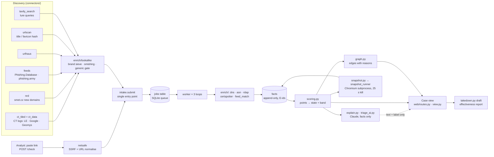

# ScamShield: technical architecture

This is a one-page summary; every claim names a file. The full specs are in `docs/specs/scamshield/` and the decisions in `docs/decisions/`.

## Pipeline

## Components

| Module | Role | File |
|---|---|---|
| App + background loops | FastAPI lifespan starts the CT log manager, feeds, search, the urlhaus, urlscan and nrd pulls, the DNS watcher, the snapshot monitor and the worker. Each runs under `supervise()` with backoff | `scamshield/app.py` |
| Source gate | The only HTTP path to third parties. It enforces size caps, pacing and 429 backoff, and returns failures as `SourceError` data | `scamshield/sources.py` |
| Context + budgets | Assembles `Ctx` and the request budgets per source and pool (manual/auto), stored in the `budgets` table | `scamshield/runtime.py` |
| CT reader | Tails static-ct names tiles; logs without names tiles use data tiles parsed with `cryptography` | `connectors/ct_tiled.py`, `connectors/ct_data.py` |
| Other discovery | Phishing lists (baseline + diffs), URLhaus, urlscan search, newly registered domains, Tavily search, "find relatives" (on click) | `connectors/*.py` |
| Brand sieve | Matches 53 UAE brands by token, homoglyph, IDN or edit distance, over every label, with a context word required for short brands | `enrich/lookalike.py`, `config/brands.yaml`, `config/scoring.yaml` |
| Intake | Upserts the domain, writes evidence facts and queues the check job (idempotency key) | `scamshield/intake.py` |
| Queue + worker | Durable job queue with claim, retries, `partial` and restart recovery; event re-checks (feed listing, DNS starts resolving, linked neighbour) | `scamshield/worker.py`, `scamshield/db.py` |
| Checks | DNS, Team Cymru ASN, RDAP (no registrant contacts), CertSpotter, phishing-list index | `enrich/*.py` |
| Scoring | Pure function: brand-fit B plus risk R gives points P, then state (OFFICIAL / REVIEW_HIGH / REVIEW / NOISE …), band (GRAY / GRAY_LOW / FURTHER) and coverage. Unknown counts as 0 points, never as benign | `scamshield/scoring.py`, `config/scoring.yaml` |
| Link graph | Strong or medium edges from shared name server, rare IP, hostname pattern, registrar + day, or kit file / panel. CDN, parking and platform hosts are excluded | `scamshield/graph.py`, `config/shared_infra.yaml` |
| Snapshot | Checks the URL, runs one Chromium per page in a subprocess, and turns the page into facts: title, form fields, logo/page dHash, favicon, exfiltration channels, parked page | `scamshield/snapshot.py`, `snapshot_runner.py`, `netsafe.py`, `config/brand_refs.json` |
| AI | Explanation (cites real E-ids only) and gray-zone judge (label only). Shared daily dollar cap | `scamshield/explain.py`, `scamshield/triage_ai.py`, `config/llm.yaml` |
| Takedown | Plain-text abuse report built from stored evidence. It refuses official domains and is never sent by the app | `scamshield/takedown.py` |
| Live mode | Heartbeats, `/healthz`, LIVE banner, watchdog launcher, effectiveness report M1–M11 | `scamshield/live.py`, `scripts/live.sh`, `tools/effectiveness.py` |
| UI | One screen with the queue and case, server-rendered with Jinja2 and htmx, plus cytoscape for the graph. All static files are vendored | `scamshield/web/` |

## Data model (SQLite, `scamshield/schema.sql`; meaning in `docs/specs/scamshield/DATA.md`)

- **domains → facts.** Every fact has `source`, `fetched_at`, `observed_at`, `status` (ok/missing/error) and `data_mode` (LIVE/DEMO/SYNTHETIC). Facts are append-only, and the evidence ID `E<n>` is `facts.id`.
- **assessments** keep the full history of each score, with `rule_version`, components and the evidence IDs used. **edges** store each link with its sentence and the evidence on both sides.
- **jobs** (the queue, with an `idem_key` UNIQUE), **cursors** (CT position per log, survives restart), **heartbeats**, **budgets** and **sources** (the status strip).
- **artifacts** are screenshot and gzipped HTML files in `data/evidence/`, named by sha256. **explanations**, **ai_reviews** and **llm_spend** track AI output, tokens and dollars per day and role.
- **feedback** holds analyst verdicts (append-only). **search_runs** and **search_results** hold searches, cached for 24 h.

## Model choices

| Decision | Choice | Why (source) |
|---|---|---|
| Who decides risk | A deterministic points formula, with every weight and threshold in `config/scoring.yaml` | It can be repeated and calibrated, and a page cannot inject a score (ADR 0005) |
| Explanation | Claude via the official `anthropic` SDK, `claude-opus-5-5`, effort low, `max_tokens` 1500 | Output is JSON with E-id claims; the validator drops any unknown ID (`config/llm.yaml`, `explain.py`) |
| Gray-zone judge | `claude-opus-5-5` | Live eval on 19 labelled gray rows: Haiku 50% accuracy with 44% "unclear", Opus 76% with 11% "unclear"; below the 85% bar, so it labels only |
| AI power over the queue | Label only. `sort_enabled: false` until the AI passes an accuracy gate on labelled cases | A hidden real fake is the worst failure |
| Spend | $5/day hard cap shared by all roles (`config/live.yaml` `m10_llm_usd_day`), judge $1/day inside it, reservation before each call | Highest day so far: $4.98 of the $5 cap (9.4-hour live run, 22 Nov 2026) |
| Untrusted input | Page text is cut to 4,000 characters per fact (judge: at most 12,000 characters per call), escaped and wrapped in `<untrusted_data>`. The model has no tools | `triage_ai.py`, `explain.py` |

## Reliability

- **Failures are data.** `sources.py` returns `SourceError`. The card shows "Not checked: <source> — <reason>", and coverage counts as "checks x/5".
- **Rate limits.** Each source has its own budget and timeout in `config/sources.yaml`. Examples: CertSpotter 60/h (40 manual + 20 auto), Tavily 40/day, urlscan 220/day, rdap.org paced at 1 request per 1.1 s with a 60 s pause after a 429. HTTP 429 triggers backoff up to 60 s.
- **Retries.** Worker retries after 2 s and 8 s, then marks the job `partial`. Running jobs are re-queued after a restart, with 0 lost and 0 duplicates in a `kill -9` drill.
- **CT throughput.** Up to 16 concurrent tile reads, a hard per-request deadline, and brand matching of full tiles in a `ProcessPoolExecutor` of 3 spawn workers with a per-name cache (`connectors/ct_tiled.py`, `match_processes`). A tile that never parses is visibly skipped, never silently dropped.
- **Monitoring.** One heartbeat per loop and per CT shard. `/healthz` and the banner show OK / degraded / OFFLINE (`config/live.yaml` `stale_s`, `offline_after_s`). `scripts/live.sh` runs a watchdog that restarts the app.
- **Concurrency.** 3 worker loops, at most 3 automatic snapshots (each its own Chromium process) plus 1 slot for analyst clicks, and 2 AI calls per role at once. SQLite runs in WAL mode, and every database call goes through `db.run` (a thread, so the event loop never blocks).

## Scaling path

| Now (laptop) | Next (police server) |
|---|---|
| SQLite file, one process | PostgreSQL (SQL kept portable, ADR 0002), several workers |
| `jobs` table + asyncio loops | Queue service. Job functions are plain async, so only `worker.py` changes (ADR 0003) |
| Snapshot subprocess on the host | Snapshot workers in a separate network segment behind an egress proxy that pins the resolved IP (ADR 0004) |
| 3 CT log operators | Every log in `log_list v3` (same reader; operators listed in `sources.yaml`) |
| Free tiers with own budgets | Paid search/Places keys with hard billing caps; Maps through a police–Google arrangement |
| No login | SSO, roles, audit log (out of scope for v1) |

## Privacy design

- **Inputs are public:** certificate logs, DNS, RDAP, ASN, public phishing lists and search results. We hold no victim data, no messages and no user accounts.
- **RDAP:** we keep only dates and registrar. Registrant name, email, phone and address are ignored (`enrich/rdap.py`, `DATA.md` "Personal data").
- **Analyst data:** the optional name and reason in `feedback` stay local and are never sent to AI or any service.
- **Sent to Anthropic:** domain facts, the assessment, edges, and the snapshot's title, form structure and page text (4,000 characters per fact). Form field values are never captured.
- **Sent to search providers:** only the fixed queries from `config/brands.yaml`.
- **Retention:** local only. Deletion is manual (move `data/` aside). There is no automatic purge in v1.

## Security

- **SSRF guard** (`netsafe.py`): blocks private, loopback, link-local, CGNAT, multicast and reserved addresses (v4 and v6) and `localhost`. Only ports 80 and 443 are allowed, and any login part in the link is stripped.
- **Sandboxed snapshot** (`snapshot_runner.py`, ADR 0004): one fresh Chromium context per page in its own subprocess, killed after 25 s. Every request is checked by a route handler. Private targets, non-GET/HEAD requests and downloads are blocked. Limits are 5 redirects, 40 MB and 150 requests. Service workers, WebRTC and Workers are refused. The browser never clicks or types.
- **Stored HTML** is gzip only and never served as HTML. The UI shows only the PNG and escaped text.
- **Accepted risk** (laptop demo only): DNS rebinding between our check and Chromium's own lookup, and a WebSocket to a public host. A server deployment needs the egress proxy above.
- **Secrets** come from `.env` (names in README). They are never logged, and Geomys gets the contact email only on its own hosts.
